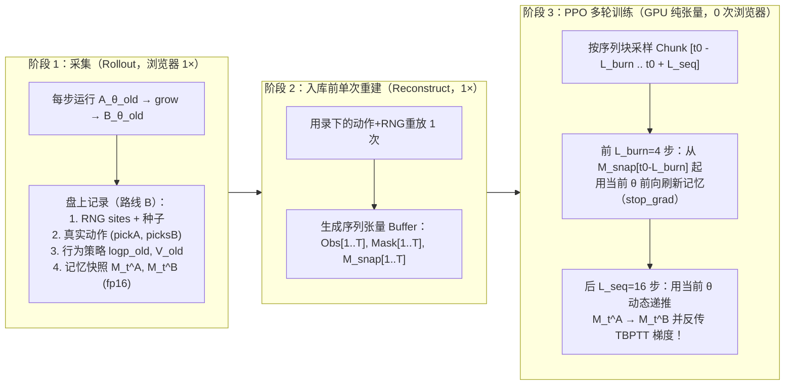
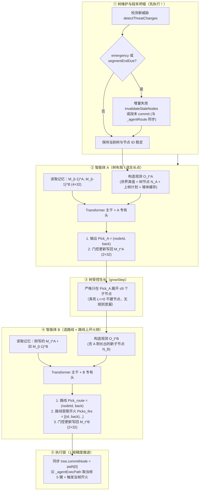

# Vantage 智能体架构全量审查、问题解决与优化设计（2026-10-16）

> **执笔角色**：架构 / 方针 AI
> **依据与权威序位**：
> 1. **主人原话**（见 `智能体架构-权威版-2026-10-07.md`、`智能体架构定案-2026-10-06.md`、`双智能体架构-2026-10-02.md §13.1`、`训练问题-待主人答-2026-10-15.md`）
> 2. **唯一权威文档**：`docs/Vantage躲弹实现/01-设计理论/权威与定案/智能体架构-权威版-2026-10-07.md`（含 `§16.7` 游戏绝对权威与 `§26` 2026-10-12 回写）
> 3. **输入交接单**：`交付-给架构方针AI-2026-10-15.md` · `当前问题与难点-2026-10-15.md`
> 4. **代码实证基线**：当前工作副本 `v199`（`game_core/js/vantage_tree.js` · `game_core/js/vantage_observe.js`）
>
> **标注约定**：
> - `【主人定案】`：主人已明确拍板的铁律，100% 原样遵守，绝不篡改。
> - `【代码实证 / 文档核查】`：经源码逐行核对抓出的真实 Bug、时序倒置或文档冲突（附精确 `文件:行号`）。
> - `【架构定稿 / 优化设计】`：在严格满足主人定案前提下，针对现有堵点与设计漏洞给出的完整工程与数学方案。

---

## §〇 总览：审查结论与核心摘要

本次审查完成了对全部设计文档与 `v199` 核心源码（`vantage_tree.js`、`vantage_observe.js`）的交叉审计：
1. **彻底解决了《当前问题与难点-2026-10-15.md》与《交付-2026-10-15.md》列出的 6 大遗留问题**（见 **§一**）；
2. **新揪出 10 个此前未被发现的致命代码/架构设计漏洞**（其中 **4 个会让智能体在真局中决策失效、动作死信或整树误抹**，**4 个会导致神经网络无法收敛或维度崩溃**，见 **§二**）；
3. **给出优化后的 `v5` 智能体网络架构与施工蓝图**（见 **§三、§四**）。

### 0.1 现有 6 大问题与难点的解决结论速查表

| # | 原问题（来自 `当前问题与难点-2026-10-15.md`） | 核心裁决与解决方案摘要 | 详见 |
|---|---|---|---|
| **1** | 🔴 **跨帧状态（`记忆槽`）打破单帧独立采样 + 路线 B 重放矛盾** | **「单次路线 B 重建 + 边界 Checkpoint + Burn-in 截断 BPTT（Chunked TBPTT）」**：<br>① 采集期只录动作 + RNG + 每隔 `C=16` 步的轻量记忆快照；<br>② 入库训练前浏览器**只重放 1 次**重建出 `[T, ...]` 观测序列（**绝不在 PPO 的多个 epoch 里重复跑浏览器**）；<br>③ PPO 训练按 `L_seq=16`（含前导 `L_burn=4` 步 `stop_grad` 预热）切块，块内用当前网络动态重算 `M_t^A → M_t^B`，梯度真实流过跨帧与同帧 `A→B` 通信。 | **§1.1** |
| **2** | 🔴 **记忆槽防退化（全写 0 / 常数坍缩）与成本失控** | ① **修正《记忆槽-成本与影响》的双重投影 Bug**：原稿把 `4×256` 展平做 `1024×256` 投影，平白增加 `+393K (+15.3%)` 参数且高维连续回归极易崩溃；<br>② **定稿「低维瓶颈门控记忆 Token（`K=2, d_mem=32`）」**：A/B 各写 `2×32=64` 维，经 **Pre-Tanh LayerNorm + GRU 残差门控** 更新（默认跨帧保持，防梯度消失），读入端共用 `Linear(32, 256) + SlotEmbed[4, 256]` 变成 4 个标准 Token，参数开销仅 **`+25.9K (+1.0%)`**；<br>③ 配套 **4 项防退化监控指标**（含 `KL(π_B(·|M_A) || π_B(·|0))` 因果敏感度）与早期辅助预测头。 | **§1.2** |
| **3** | 🔴 **三处文档对记忆槽尺寸说法不一**（`2×4` vs `留空 0` vs `1024`） | **正式统一口径**：<br>· `vantage_observe.js`（世界+树观测编码器）内**保持 `0` 维记忆**（不塞 `0` 填充、不污染 `obsHash`）；<br>· 记忆作为**智能体运行器状态**（`tree._agentMemoryA / B`，各 `2×32` float32），在网络输入层独立编码为 **`4` 个 `d=256` 的 `MEM_TOKENS`**。 | **§1.3** |
| **4** | 🟡 **`parentIdx` 改 `parentUid`（`§16.4`）未施工 + 拓扑指针直喂线性层漏洞** | ① **数据层**：`NODE_FIELDS` 第 2 列正式改为 `'parentUid'`（根父为 `-1`），彻底满足集合置换不变性；<br>② **网络层重大修正**：**严禁把 `uid` / `parentUid` 当连续浮点数喂进 `Linear(10, 256)`！** 拆分为「8 维纯物理/层深特征投影」+「随机正交节点 ID 绑定 + 树相对位置注意力偏置（Tree-Relative Attention Bias）」。 | **§1.4** |
| **5** | 🟡 **采集器收尾项（段边界获取、作弊开关表、分片）** | ① **段边界现成信号**：`vantage_tree.js:7323, 7421` 每次 `commit()` 已自增 `tree.stats.commits`（重锚自增 `stats.freshRoots`），直接由 `VantageTree.getTree().stats.commits` 读取，零侵入；<br>② 给出课程表全阶段作弊位掩码表与分片规范。 | **§1.5** |
| **6** | 🟡 **`A` 样本 `2.6 MB/局`（`131 KB/条`）体积过大** | 根因是 `collect_v6.js` 把 `collectAgentNodes` 存成了带冗余键名的 JSON 文本。路线 B 下重放时树确定性重建，录盘**无需存 `A` 节点列表（`0 KB`）**；若存二进制紧凑表（`16 B/节点`），单条仅 `13.6 KB`（**缩小 `10×`**）。 | **§1.6** |

---

### 0.2 本次审计新发现的 10 个设计/代码漏洞速查表

| 编号 | 级别 | 漏洞位置（`v199` 实证） | 核心危害 | 修复章节 |
|---|---|---|---|---|
| **V1** | 🚨 **最高危** | `vantage_tree.js:8287-8551` (`tick`) | **同帧时序倒置**：`A → growStep → B` 跑在 `emergency`（新弹失效）和 `segmentEndDue / commit` **之前**！导致：<br>① 新弹出现帧 A/B 在未失效的旧树上盲选；<br>② 选完同帧立刻被 `freshRoot` 抹掉刚长的 9 个子节点；<br>③ `nextNodeId = 1` 重置导致 `_agentRoute` 旧 ID 与新树根子节点 `1..9` **串味碰撞**。 | **§2.1** |
| **V2** | 🚨 **最高危** | `vantage_tree.js:7040-7176, 8476, 8579` | **执行层与树生命周期脑裂**：坦克按 `_agentRoute` 走，但树的段末坍缩与对齐检查仍锚在 `tree.commitNode`，且 `commit()` 用规则分 `prev.next` 选继承分支！B 一换路线就会触发 `alignHard` 误抹整棵树。 | **§2.2** |
| **V3** | 🚨 **高危** | `vantage_tree.js:4412, 4430, 4571, 6675, 8584` | **`Pick.back` 在 A/B 两端全成死信**：<br>① `A` 端丢弃 `picks[0].back` 且拒绝非叶节点，A 的 `back` 输出头对环境**零作用（零梯度）**；<br>② `B` 端漏验且丢弃 `picks[0].back`，执行层永远走满 `L` 帧而非 `L - back` 帧。 | **§2.3** |
| **V4** | 🔴 **高危** | `vantage_tree.js:6758-6803` (`growStep`) | **智能体模式下规则生长泄漏**：当 `_growBoosts` 非空时，`layersPerTick > 1`，第 2..K 次循环偷偷调用规则 `pickGrowLeaf`，且仍执行 `applyRetreatAfterExpand` 和 `splitLongSegmentLeaf`。 | **§2.4** |
| **V5** | 🔴 **高危** | `vantage_observe.js:202, 541` & `v4 §三` | **异构 Token 扁平化 Bug + 坐标系割裂 + 角度跳变**：<br>① `encodeGlobal` 把动态数量的道具/地雷算进 `global.dim`，扁平拼接会导致每帧输入维度跳变；<br>② 节点 `(dx,dy)` 锚在陈旧 `rootPose`（世界轴），而子弹/对手在绝对世界系；<br>③ 角度在 `±π` 处不连续跳变。 | **§2.5** |
| **V6** | 🟠 **中高危** | `vantage_tree.js:4190` & `vantage_observe.js:452` | **`上帧计划 plan` 恒为默认值 + 标量 `uid` 跨帧断层**：`buildAgentCtx` 未传 `ctx.plan`；且网络无法把全局里的标量 `leafId` 与节点 Token 对上号。改为**节点内联计划标记（`inLastRoute`, `lastFireOffset`）+ 全局摘要**。 | **§2.6** |
| **V7** | 🟠 **中高危** | `交付:111` vs `vantage_tree.js:8297` | **决策频率冲突**（「每 10 帧」vs「每帧」）：纯 JS 跑 `N=1000` 全注意力约 `120~180 ms/次`，每帧跑 2 次会卡死实时帧率。建立**执行时钟（1 帧）与决策时钟（`K_decide` 帧 + 事件中断）解耦机制**。 | **§2.7** |
| **V8** | 🔴 **高危** | `智能体版-网络架构方针-2026-10-13.md (v4)` | **输出头与动作掩码数学规范缺失**：补齐 `Pick=(nodeId, back)` 的 **Pointer-Offset 自回归头** 与 **路线受限开火头（Route-Constrained Fire Head）**，用硬掩码从根源上保证 **100% 语义合法（0 次重试）**。 | **§2.8** |
| **V9** | 🟡 **中危** | `vantage_observe.js:298` & `v4 §二 A2` | **静态墙体几何完全缺失**：网络看不见对手周围的墙与反弹角。落实 `权威版 §16.2(b)`，增加**每局算一次并缓存 KV 的静态迷宫墙体 Token 段（`≤40` tokens）**。 | **§2.9** |
| **V10** | 🟡 **中危** | `vantage_tree.js:4156, 4680` | **全真死绝境兜底（`权威版 §7.3c`）未实现**：当根的 9 个方向全部 `L <= 0`（真死）时，`collectAgentNodes` 只剩根，`B` 无节点可选必败弃权。补齐 `allTrueDead` 候选暴露机制。 | **§2.10** |

---

## §一 现有六大问题与难点的完整解决方案

### 1.1 【问题 #1】跨帧状态（`记忆槽` 打破单帧独立采样）与路线 B 重放训练架构

#### （1）问题本质剖析
引入记忆槽后，$M_t^A = f_\theta(O_t^A, M_{t-1}^A, M_{t-1}^B)$，$M_t^B = f_\theta(O_t^B, M_t^A, M_{t-1}^B)$。这带来两个层面的耦合：
1. **梯度层面**：如果在 PPO 训练时把每一帧当成独立样本（i.i.d.）打乱采样，或者直接把采样时的旧记忆 $M_{t-1}^{\text{old}}$ 当成常数输入而不反传梯度，那么**写记忆头（Memory Write Head）将完全收不到来自未来帧和同帧 B 的梯度**（或者只剩同帧 `A→B` 的 1 步梯度，跨帧梯度为 0），网络永远学不会往跨帧记忆里写有用信息。
2. **路线 B 重放层面**：路线 B 的核心优势是「盘上只存动作 + RNG，训练时重放重建观测」。但 PPO 对同一批 Rollout 要迭代 `K_epoch = 3 ~ 4` 轮、切成多个 minibatch 更新参数 $\theta$。如果在每个 epoch 里都为了拿新 $\theta$ 下的记忆而重新跑一遍浏览器，训练速度会慢 `4×` 且因为新记忆改变了动作概率而破坏 on-policy 对齐。

#### （2）【架构定稿】两阶段解耦：「单次重放重建 + 边界快照 + Burn-in 截断 BPTT」

我们将**「物理世界/树观测的重建」**与**「神经网络内部记忆状态的梯度反传」**彻底解耦：



**具体工程规约**：
1. **浏览器绝不按 Epoch 重复跑**：
   - 在线训练（On-Policy PPO）时，采集进程在内存中直接保留当前 Rollout 的紧凑观测张量（跑完 4 个 PPO epoch 后即刻释放内存，磁盘只存路线 B 的轻量录像用于复盘/回放）；
   - 从磁盘路线 B 录像恢复训练时，每个 Episode **只跑 1 次重放**把 `[T, ...]` 观测序列解出来送入 GPU 显存/共享内存池，后续 `K_epoch = 4` 个 epoch 全部在纯 PyTorch 张量上运行。
2. **为什么观测 $O_t$ 在 PPO 的 4 个 Epoch 内固定是严格正确的？**
   - 在 PPO（以及 R2D2 / IMPALA / Recurrent PPO 标准范式）中，Rollout 轨迹的物理状态转移 $s_0, a_0, s_1, a_1, \dots, s_T$（包含树的生长轨迹，因为 `A` 当时选的生长动作 $a_t^A$ 是轨迹的一部分）是由行为策略 $\pi_{\theta_{\text{old}}}$ 采样固定的。
   - PPO 优化的目标是重要性采样比率：
     $$r_t(\theta) = \frac{\pi_\theta(a_t^A \mid O_t^A, M_{t-1}^A(\theta), M_{t-1}^B(\theta)) \cdot \pi_\theta(a_t^B \mid O_t^B, M_t^A(\theta), M_{t-1}^B(\theta))}{\pi_{\theta_{\text{old}}}(a_t^A, a_t^B \mid \text{old})}$$
   - 在每个长度为 $L_{\text{burn}} + L_{\text{seq}} = 4 + 16 = 20$ 步的连续子序列（Chunk）上：
     - **起点初始化**：从 `t0 - L_burn` 处读取采样时存下的记忆快照 $M_{t_0 - L_{\text{burn}}}^{\text{snap}}$（仅 `128` 个 `fp16` = `256 B`）；
     - **Burn-in 预热段（4 步，`torch.no_grad()`）**：用当前最新权重 $\theta$ 跑 4 步前向，消除旧权重快照与新权重 $\theta$ 的分布漂移；
     - **BPTT 梯度段（16 步，开启梯度）**：
       - 第 $t$ 步：`A` 读 $(O_t^A, M_{t-1}^A, M_{t-1}^B)$，输出动作分布 $\pi_\theta(a_t^A)$ 与新记忆 $M_t^A$；
       - 同帧紧接着：`B` 读 $(O_t^B, \mathbf{M_t^A}, M_{t-1}^B)$，输出动作分布 $\pi_\theta(a_t^B)$ 与新记忆 $M_t^B$；
       - **关键梯度通路**：
         1. **同帧 `A → B` 梯度**：$B$ 在第 $t$ 步的策略损失 $\mathcal{L}_t^B$ 和价值损失直接通过 $M_t^A$ 反传回 $A$ 的写记忆头！（延迟为 **0 帧**，极其强烈、直接！）
         2. **跨帧 `B_{t-1} → A_t` 与自回归梯度**：通过 16 步 TBPTT 反传。
3. **局边界截断（Episode Boundary Mask）**：
   - 当序列块内遇到 `done[t] == 1`（换图或终局）时，强制乘以 `(1.0 - done[t])` 将 $M_t^A, M_t^B$ 清零，严格符合「每局清空，不跨局保留」。

---

### 1.2 【问题 #2】记忆槽防退化设计、瓶颈维度优化与四项监控指标

#### （1）【文档核查】揪出《记忆槽-成本与影响-2026-10-15.md》中的双重设计漏洞
核查 `记忆槽-数据格式设计-2026-10-15.md` 与 `记忆槽-成本与影响-2026-10-15.md`，发现两处严重问题：
1. **双重投影漏洞（白白膨胀 `+393K` 参数）**：
   - 《数据格式设计 §一》定的是「记忆是 token 段，直接是 `K=2` 个 `d=256` 的 token，**不用额外投影层**」；
   - 但《成本与影响 §一》在算参数量时，却把 `2 × 2 × 256 = 1,024` 维当成扁平特征，乘了一个 `1024 × 256 = 262,144` 的输入投影矩阵 + `256 × 512 = 131,072` 的输出头，合计 **`+393,216` 参数（占整个 2.57M 网络的 `+15.3%`）**！如果记忆已经是 `d=256` 的 4 个 Token，拼成一个 `1024` 维向量再压成 `1` 个 `256` 维 Token 不仅违背了「作为独立 Token 参与 Attention」的设计，还把 4 个槽压扁成了 1 个。
2. **高维连续动作坍缩与梯度饱和风险**：
   - 让网络在没有监督标签的情况下，直接通过 `Linear(256, 512) + tanh` 输出 `512` 维连续向量：
     - 一旦初始权重或某次更新导致 `Linear` 输出绝对值 $> 3$，$\tanh'(x) = 1 - \tanh^2(x) < 0.01$，**梯度直接归零（死区饱和）**；
     - 若每帧都全量覆写 $M_t = \tanh(W h_t)$，网络为了把第 $t$ 帧的意图保持到第 $t+5$ 帧，必须学会在连续 5 帧里反复把输入记忆原样拷贝到输出——在强化学习早期噪声下，信息在 2~3 帧内就会指数级衰减为常数或全 0。

#### （2）【架构定稿】「低维瓶颈 + Pre-Tanh LayerNorm + GRU 门控残差」记忆槽架构

为了兼顾**表达力**、**零梯度饱和**、**跨帧自然保持**与**极低参数/存储开销**，定稿如下：

1. **槽数与瓶颈维度**：
   - 每个智能体拥有 $K = 2$ 个记忆 Token（槽 0 倾向承载「当前战术/目标区域意图」，槽 1 倾向承载「风险/跨帧持续状态」，具体内容由网络端到端自发分工）；
   - 每个记忆 Token 采用**低维信息瓶颈** $d_{\text{mem}} = 32$（单智能体输出 $2 \times 32 = 64$ 维；A+B 合计 $4 \times 32 = 128$ 维 float）。
   - **为什么 $d_{\text{mem}} = 32$ 远优于 $256$？**
     在 TankTrouble 中，A 与 B 之间需要互通的核心隐状态（例如：A 准备往哪个象限扩树、哪条分支正在被重点探测、B 打算锁死哪条躲弹走廊、未来几帧是否准备开火）本质自由度在 $10 \sim 30$ 维以内。将每槽限制在 $32$ 维（2 槽共 $64$ 维），既能编码极其丰富的连续战术向量，又将连续搜索空间压缩了 $8\times$，并通过 `Linear(32, 256)` 升维进入 Transformer 的 `256` 维注意力空间。

2. **写入端（Write Head）：Pre-Tanh LayerNorm + 门控残差更新（彻底解决全 0 退化与饱和）**
   设智能体（A 或 B）的聚合读出向量为 $h_t \in \mathbb{R}^{256}$，上帧自己的第 $k \in \{0, 1\}$ 号记忆槽为 $m_{t-1}^{(k)} \in [-1, 1]^{32}$：
   - **候选记忆（带无偏置 LayerNorm 防饱和）**：
     $$z_t^{(k)} = \text{LayerNorm}_{\text{no-bias}}\!\left(W_{\text{cand}}^{(k)} h_t\right) \cdot \gamma_0, \quad \tilde{m}_t^{(k)} = \tanh\!\left(z_t^{(k)}\right) \in (-1, 1)^{32}$$
     其中缩放系数初始化为 $\gamma_0 = 0.8$。由于经过了 `LayerNorm`，$z_t^{(k)}$ 的均值为 0、标准差恒为 $0.8$，**绝不会落入 $|\tanh(z)| > 0.99$ 的梯度死区**，同时**也绝不会全部塌缩为 0**！
   - **遗忘/写入门（Update Gate）**：
     $$g_t^{(k)} = \sigma\!\left(W_{\text{gate}}^{(k)} [h_t \,;\, m_{t-1}^{(k)}] + b_{\text{gate}}\right) \in (0, 1)^{32}$$
   - **状态递推更新**：
     $$m_t^{(k)} = \left(1 - g_t^{(k)}\right) \odot m_{t-1}^{(k)} + g_t^{(k)} \odot \tilde{m}_t^{(k)}$$
   - **关键初始化技巧**：将 $b_{\text{gate}}$ 初始化为 **$-1.0$**（此时初始 $g_t \approx \sigma(-1.0) \approx 0.27$）。这意味着在训练第 0 步，记忆就天然具备 $\approx 4$ 帧的指数移动平均半衰期——**网络不需要先学会「怎么把上一帧记忆抄到下一帧」，默认就能跨帧留存信息**，只有当遇到新威胁或换路线时才开大 $g_t$ 覆写！

3. **读取端（Read Tokenizer）：4 个独立 Token 直接送入 Attention**
   对于第 $t$ 帧的任意智能体，输入记忆包含 4 个槽：$\{m^A_0, m^A_1, m^B_0, m^B_1\}$（对 A 而言读的是 $M_{t-1}^A, M_{t-1}^B$；对 B 而言读的是**刚更新的 $M_t^A$** 和 $M_{t-1}^B$）：
   $$\text{Tok}_{\text{mem}}^{(s)} = \text{LayerNorm}\!\left(W_{\text{in}} m^{(s)} + E_{\text{slot}}[s]\right) \in \mathbb{R}^{256}, \quad s \in \{0, 1, 2, 3\}$$
   其中 $W_{\text{in}} \in \mathbb{R}^{256 \times 32}$ 为共享升维矩阵，$E_{\text{slot}} \in \mathbb{R}^{4 \times 256}$ 为可学习的槽位身份嵌入（明确区分「这是 A 的槽 0/1」还是「B 的槽 0/1」）。

4. **成本对比（修正后 vs 原《成本与影响》稿）**：

| 指标 | 原《10-15 成本稿》（`K=2, d=256` 扁平投影） | **定稿方案（`K=2, d_mem=32` 瓶颈门控 Token）** | 优化幅度 |
|---|---|---|---|
| 单智能体记忆维度 | `512` floats (`2 KB`) | **`64` floats (`256 B` / `128 B` fp16)** | **省 `8×`** |
| A+B 总记忆维度 | `1,024` floats (`4 KB`) | **`128` floats (`512 B` / `256 B` fp16)** | **省 `8×`** |
| 输入投影参数量 | `1024 × 256 = 262,144` | `32 × 256 + 4 × 256 = 9,216` | **省 `28.4×`** |
| 输出写入头参数量 | `256 × 512 = 131,072` | `2 × (256×32 + 288×32) ≈ 34,816`（若 A/B 共享则 `17,408`） | **省 `3.8× ~ 7.5×`** |
| **总新增参数量（占比）** | **`+393,216`（`+15.3%`）** | **`+26,624 ~ +44,032`（`+1.0% ~ +1.7%`）** | **开销降低 `10×`** |
| Attention 新增 Token 数 | `4` 个 | **`4` 个** | 持平（仅 `+0.4%` 序列长） |

#### （3）训练期防退化的「四项硬性诊断指标」与「轻量辅助热启动」
在训练日志（TensorBoard / CSV）中必须每百步记录以下 **4 项指标**，任何一项异常即可秒级定位：
1. **跨样本方差（Cross-State Variance）** $V_{\text{batch}} = \frac{1}{64}\sum_{j=1}^{64} \text{Var}_{\text{batch}}(m_{t,j})$：
   - **判据**：若 $V_{\text{batch}} < 10^{-3}$，说明不论场上发生什么，网络都在写同一个常数向量（常数坍缩）。
2. **帧间动态率（Temporal Update Rate）** $\Delta_{\text{temp}} = \mathbb{E}\left[\|M_t - M_{t-1}\|_2\right]$ 与门控均值 $\bar{g} = \mathbb{E}[g_t]$：
   - **判据**：若 $\bar{g} \to 0$，记忆冻结不更新；若 $\bar{g} \to 1$，记忆退化为无状态瞬时传声筒。健康区间为 $\bar{g} \in [0.10, 0.65]$。
3. **饱和率（Saturation Ratio）** $S_{\text{sat}} = \Pr(|m_{t,j}| > 0.95)$：
   - **判据**：有 Pre-Tanh LayerNorm 保护下，$S_{\text{sat}}$ 应稳定 $< 5\%$；若 $> 20\%$ 说明 $\gamma$ 过大导致梯度消失。
4. ⭐ **A→B 因果敏感度（Ablation KL Divergence，最关键指标）**：
   $$I_{A \to B} = D_{\text{KL}}\!\left(\pi_B(\cdot \mid O_t^B, M_t^A, M_{t-1}^B) \;\Big\|\; \pi_B(\cdot \mid O_t^B, \mathbf{0}, M_{t-1}^B)\right)$$
   - 在每个评估批次中，将送给 B 的 $M_t^A$ 临时置 0 跑一次无梯度前向，算 B 动作分布的 KL 散度。
   - **判据**：若 $I_{A \to B} \approx 0$，直接证明 **B 在无视 A 的记忆（只写不读）**；若 $I_{A \to B} > 0.02\text{ nats}$，证明 **B 真实依赖 A 写入的当帧意图**！
5. **可选热启动（完全不改主奖励函数）**：
   - 在训练前中期（阶段 `前置` 与 `1′`），给记忆槽挂一个仅在训练期存在、推理期丢弃的轻量线性探针（Linear Probe）：用 $M_t^A$ 线性预测 A 刚选中的节点相对坐标 $(\Delta x_A, \Delta y_A, t_{\text{rel}, A})$，用 $M_t^B$ 线性预测 B 刚选中的路线终点 $(\Delta x_B, \Delta y_B)$（辅助 MSE 权重 $\lambda_{\text{aux}} = 0.05$，随训练退火至 $0$）。这会在第 1 个 Epoch 就强迫 A/B 把自己的空间意图写进记忆槽，并让对方立即读到有明确几何意义的向量，彻底杜绝初期盲目探索导致的「双盲博弈死锁」。

---

### 1.3 【问题 #3】三处文档记忆槽尺寸不一致的统一裁决

| 原文档 | 原表述 | 裁决状态 |
|---|---|---|
| `智能体架构定案-2026-10-06.md §二` | 包含在 `1 × 48` 全局向量中，占 `2 × 4 = 8` 维 | **❌ 废止**（早期粗略占位） |
| `智能体版-网络架构方针-2026-10-13.md (v4) §三` | `记忆槽 A/B` 标为 `留空 0`，总维数 `10,540` 不含记忆槽 | **✅ 保留为 `vantage_observe.js` 的边界定义**（观测编码器内不放记忆） |
| `记忆槽-数据格式设计-2026-10-15.md` | 独立 token 段 `2 × 2 × 256 = 1,024` 维 | **🔄 修正为瓶颈 Token：`2 × 2 × 32 = 128` 维（经 `Linear(32, 256)` 升维为 `4 × 256` Token）** |

**【统一契约（写死）】**：
1. **`VantageObserve.encode(ctx)` 不编码记忆槽**：`vantage_observe.js` 只负责把「游戏世界真值 + 树节点预测 + 上帧计划事实」编码为纯观测，绝不在里面塞 `0` 填充数组。这样 `obsHash` 只反映客观环境状态。
2. **记忆槽归属智能体运行器（Agent Runner）与训练器（Trainer）**：
   - 在 JS 侧挂于 `tree._agentMemory = { A: new Float32Array(64), B: new Float32Array(64) }`，在 `resetTree()` / 新局初始化时 `.fill(0)` 清零；
   - 在 `agentSeam(tree, 'A', adapter)` 调用模型时，传入 `{ obs, memA: tree._agentMemory.A, memB: tree._agentMemory.B }`，模型返回 `{ picks, memOut }` 后覆写 `tree._agentMemory.A.set(memOut)`；
   - 同帧随后 `agentSeam(tree, 'B', adapter)` 传入刚更新的 `tree._agentMemory.A` 与旧 `tree._agentMemory.B`，模型返回后覆写 `tree._agentMemory.B.set(memOut)`。

---

### 1.4 【问题 #4】`parentIdx` 改 `parentUid`（`§16.4`）与图结构位置编码漏洞修复

#### （1）【架构漏洞揭示】为什么「把 `uid` 和 `parentIdx` / `parentUid` 当浮点数喂给 `Linear(10, 256)`」在数学上是错的？
当前 `vantage_observe.js:48` 定义：
```js
var NODE_FIELDS = ['uid', 'parentIdx', 'slot', 'depth', 'tRel', 'L', 'dx', 'dy', 'dRot', 'hasGrown'];
```
而在 `v4` 架构中，直接用 `Linear(10, 256)` 把这 10 个数乘上权重矩阵 $W \in \mathbb{R}^{256 \times 10}$：
$$h_i = W_0 \cdot \text{uid}_i + W_1 \cdot \text{parentIdx}_i + W_2 \cdot \text{slot}_i + \dots$$
这存在 **3 个根本性的数学错误**：
1. **伪造线性量级关系**：在实数线性层眼里，`uid = 300` 的激活贡献是 `uid = 100` 的 **3 倍**！而 `uid` 只是一个自增分配器编号（`tree.nextNodeId++`），`300` 和 `100` 之间没有任何倍数关系。
2. **点积注意力无法通过标量乘积匹配父子相等性**：Transformer 要判断「节点 $j$ 是不是节点 $i$ 的父亲」，需要判别 $\text{parentUid}_i \stackrel{?}{=} \text{uid}_j$。两个一维标量乘进线性层后做点积 $(w_p \cdot \text{parentUid}_i)(w_u \cdot \text{uid}_j) \propto \text{parentUid}_i \cdot \text{uid}_j$，它是单调递增的双线性积，**根本不是相等性核函数 $\delta(\text{parentUid}_i, \text{uid}_j)$**！网络无法靠一维标量学会「找到我的父节点」。
3. **破坏集合置换等变性（违反 `权威版 §16.4`）**：若用数组下标 `parentIdx`，打乱节点顺序会导致输入数值改变；若用自增 `uid`，同一棵几何形状完全相同的树，仅仅因为中途多长过几个已被剪掉的分支导致 `nextNodeId` 偏移了 `+50`，所有节点的 `uid` 和 `parentUid` 就会整体加 `50`，导致节点嵌入整体漂移！

#### （2）【架构定稿】数据层改 `parentUid` + 网络层「物理特征与拓扑结构彻底分离」

1. **数据层改造（`vantage_observe.js`）**：
   - 将 `NODE_FIELDS` 第 2 列正式由 `'parentIdx'` 改为 **`'parentUid'`**（根节点 `parentUid = -1`）。
   - 修改位置（全文件仅 3 处）：
     - `vantage_observe.js:48`：`'parentIdx'` $\to$ `'parentUid'`
     - `vantage_observe.js:183-186, 211`：去掉 `uidToIdx` 映射，直接写 `pUid = (n.parentId == null || n.parentId < 0) ? -1 : n.parentId; out[base + 1] = pUid;`
     - `vantage_observe.js:756`（`buildScene`）：内部用一个局部 `uidToPos` 字典即可还原父节点连线，对外接口 100% 保持不变。
   - **收益**：`encodeNodes` 输出的每一行 `[uid, parentUid, slot, depth, tRel, L, dx, dy, dRot, hasGrown]` 对节点数组任意重排（Permutation）**100% 数值不变**，且少做一次 JS 字典二次回填。

2. **网络层改造（Node Tokenizer）：剥离整型 ID，注入真图结构（Tree-Aware Transformer）**：
   - **第 1 步：只把纯物理与局部属性喂入节点特征编码器**：
     - 剥离第 0 列 `uid` 和第 1 列 `parentUid`（它们只作拓扑索引和外部动作寻址，**绝不作为连续浮点数乘进 `Linear`！**）；
     - 槽位 `slot ∈ {-1, 0..8}`：用 `Embedding(10, 32)`（其中 `slot + 1` 映射到 `0..9`），因为槽位 `0..8` 是 9 个离散运动方向类别，不是线性标量！
     - 连续/二值属性（8 维）：`[depth / 10.0, tRel, L / 75.0, dx / 40.0, dy / 40.0, sin(dRot), cos(dRot), hasGrown]`；
     - 拼接为 $32 + 8 = 40$ 维，经 `Linear(40, 256) + LayerNorm + GELU` 得到纯物理节点表征 $h_i^{\text{phys}} \in \mathbb{R}^{256}$。
   - **第 2 步：用「随机正交指针绑定 + 树相对注意力偏置」表达父子与祖先关系**：
     - **方案 A（零 $O(N^2)$ 开销，线性复杂度兼容 FlashAttention）—— 随机正交句柄绑定（Random Orthogonal Handle Binding）**：
       每次前向时，为当前树中出现的每个唯一节点 $i \in \{0..N-1\}$ 从预生成的正交单位向量池 $U \in \mathbb{R}^{1024 \times 64}$ 中抽取（或按当前树内局部序号映射）一个句柄向量 $e_i \in \mathbb{R}^{64}$，其父节点的句柄即为 $e_{\text{parent}(i)}$：
       $$h_i = h_i^{\text{phys}} + W_{\text{self}} e_i + W_{\text{par}} e_{\text{parent}(i)}$$
       由于 $\langle e_i, e_j \rangle \approx \delta_{ij}$，自注意力层只需通过 $Q = W_Q h_i, K = W_K h_j$ 即可做到 $\langle W_Q W_{\text{par}} e_{\text{parent}(i)}, W_K W_{\text{self}} e_j \rangle \propto \delta(\text{parent}(i), j)$，**一层的点积就能精确找到父节点、子节点和同父兄弟节点**，且对全局 `uid` 偏移 100% 免疫！
     - **方案 B（显式树拓扑偏置，可与方案 A 叠加）—— 树相对位置偏置（Tree-Relative Attention Bias）**：
       利用 `uid` 和 `parentUid` 在 $O(N)$ 时间内算出每个节点的父指针 `p[i]`，构造节点间关系矩阵 $R_{ij} \in \{0:\text{自身}, 1:\text{父}, 2:\text{子}, 3:\text{同父兄弟}, 4:\text{2步祖先}, 5:\text{2步后代}, 6:\text{同根分支(同首层slot)}, 7:\text{其它}\}$：
       $$\text{Attn}(Q, K, V)_{ij} = \text{softmax}_j\!\left(\frac{Q_i K_j^\top}{\sqrt{d_k}} + b_{\text{head}}[R_{ij}]\right) V_j$$
       每个注意力头仅需 `8` 个可学习标量 $b_{\text{head}} \in \mathbb{R}^8$（全网 3 层 × 8 头共仅 **`192` 个参数**！），就能让注意力头天然具备「沿树向上聚合后代存活率」或「沿树向下追溯祖先路径」的能力！

---

### 1.5 【问题 #5】采集器收尾项（段边界精确信号、作弊开关表、分片落盘）

1. **【代码实证】页面内现成的「段边界」精确信号（无需碰物理层，零侵入）**：
   - 核查 `vantage_tree.js:7323` 与 `:7421`，在 `commit()` 函数每次完成段提交时，代码已经维护了精确计数器：
     - `tree.stats.commits`：每次发生段提交（含普通推进与 `freshRoot` 重建）必 `+1`；
     - `tree.stats.freshRoots`：每次发生整树重锚（`freshRoot`）必 `+1`；
     - `tree.root.id`：当前根节点的 `uid`。
   - 这三个值已经通过 `window.VantageTree.getTree().stats` 和 `window.VantageTree.dumpDiagnostics().stats` 暴露在页面全局！
   - **采集器判定规约**：
     ```js
     const tree = window.VantageTree.getTree();
     const curCommits = tree && tree.stats ? tree.stats.commits : 0;
     const curFresh = tree && tree.stats ? tree.stats.freshRoots : 0;
     const isSegmentBoundary = (curCommits !== lastCommits);
     const isFreshRoot = (curFresh !== lastFresh);
     ```
     当 `isSegmentBoundary === true` 时，即为 100% 精确的段边界帧。

2. **训练课程全阶段作弊位掩码表（`cheatMask` 规约）**：
   为了在路线 B 录像头（Header）中紧凑记录该局使用了哪些训练辅助开关，定义 8-bit 掩码 `cheatMask`：

   | Bit | 掩码值 | 开关名称 | 作用阶段 | 页面执行点 |
   |---|---|---|---|---|
   | `0` | `0x01` | `INVINCIBLE_SELF` | 阶段 `1′`（移动/定点射击） | 屏蔽己方坦克受弹判死，专注走位与射击 |
   | `1` | `0x02` | `INVINCIBLE_OPP` | 阶段 `3`（纯躲弹，对手=随机射击源） | 射击源不死，配合定时换图 |
   | `2` | `0x04` | `INFINITE_AMMO` | 阶段 `1′ / 4 / 5 / 6` 射击密集训练 | `reload` 立即归零或缩短至固定帧 |
   | `3` | `0x08` | `DISABLE_CRATES` | 阶段 `前置 / 1′ / 3 / 4 / 5 / 6` | 关闭道具箱生成（仅阶段 `7 / 8` 开启） |
   | `4` | `0x10` | `FIXED_TARGET` | 阶段 `1′`（定点靶） | 对手锁定零输入（静止靶） |
   | `5` | `0x20` | `RANDOM_SHOOTER` | 阶段 `3 / 5 / 6` | 对手由确定性 RNG 驱动随机游走并发射不同弹种 |

3. **分片落盘规约**：
   - 采用固定帧数分片（每片 `2,000` 帧或按局切分 `1 局 = 1 条 JSONL/二进制块`），单文件上限 `50 MB` 自动滚动 `shard_0001.bin`，每个 shard 头部写入 `rngSites` 完整快照，保证任意 shard 可独立重放。

---

### 1.6 【问题 #6】`A` 样本 `2.6 MB/局`（`131 KB/条`）膨胀根因与 `10× ~ ∞` 瘦身方案

#### （1）膨胀根因
`collect_v6.js` 在采集 `A` 样本时，直接对 `VantageTree.collectAgentNodes(tree)` 的返回值做了 `JSON.stringify`。每个节点包含 `{id, parentId, slot, depth, tRel, L, endPose: {x, y, rot}, hasGrown, segmentFrames, samples}` 等冗长 ASCII 键名，850 个节点即达 `131 KB/条`，一局 20 次采样即 `2.6 MB`。

#### （2）【架构定稿】两级瘦身方案
1. **在路线 B（重放建树）下：`A` 样本无需落盘节点列表（体积 = `0 B`）**
   - 路线 B 的定义就是「盘上只存动作流 + RNG 站点，重放时页面确定性重建整棵树和观测」。既然重放每一帧时 `VantageObserve.encode(ctx)` 都会原地算出 `nodes.data (Float32Array)`，**落盘文件里只需要存 `A` 当帧选出的动作 `[nodeId, back]`（仅 `4 Bytes`！）**，根本不需要把 850 个节点的 JSON 存进磁盘！
2. **在离线特征缓存（或阶段 `前置` 快速合法性预训练）下：紧凑二进制 `16 B/节点`（压缩 `10×`）**
   - 直接导出 `VantageObserve.encodeNodes(tree)` 的 `Float32Array(N * 10)`（`850 × 10 × 4B = 34 KB`），或转存为紧凑结构：
     `uid (int16) + parentUid (int16) + slot (int8) + depth (uint8) + L (uint8) + hasGrown (uint8) + tRel (float16) + dx (float16) + dy (float16) + dRot (float16)` = **每节点严格 `16 Bytes`**！
   - `850` 个节点仅 **`13.6 KB/条`**（比 `131 KB` 缩小 **`9.6×`**），20 条/局仅 **`272 KB`**（Zstd/Gzip 后 `< 80 KB/局`）。

---

## §二 深度代码与设计审计：新发现的 10 个致命设计/实现漏洞及修复方案

在逐行审查 `game_core/js/vantage_tree.js`（`v199`）、`game_core/js/vantage_observe.js`（`v199`）与《智能体版-网络架构方针-2026-10-13.md》（`v4`）时，我们发现了 **10 个此前未被记录的深层漏洞**。以下逐一列出源码证据、灾难推演与精确修复方案。

---

### 2.1 【漏洞 V1 · 🚨最高危】`vantage_tree.js:8287-8551` 同帧时序倒置：智能体跑在 `emergency` 和 `commit` 之前

#### （1）【权威定案】vs【代码实证】
- **`智能体架构-权威版-2026-10-07.md §九`（第 4741-4752 行）规定的唯一合法逐帧时序**：
  ```
  ① 规则系统维护：增量失效（新子弹出现时砍死节点）· 段末 commit（坍缩到下一层、重编号）
  ② 智能体 A 跑一次 → 输出 1 个 Pick = (nodeId, back)
  ③ 树生长：在 A 指定的节点长出 ≤ 9 个子节点（真死不建节点 + hasGrown = true）
  ④ 智能体 B 跑一次 → 输出 K 个 Pick（picks[0] = 路线，picks[1..] = 射击帧）
  ⑤ 执行层：按 B 的路线取当帧 5 键，按射击帧叠加 fire
  ```
- **而 `vantage_tree.js:8287-8551`（`v199` 实际代码）写的顺序却是反过来的**：
  - **行 `8295-8366`**：**先跑了 `agentSeam('A') → growStep → agentSeam('B')`**！
  - **行 `8369-8374`**：然后才跑分片提交 `stepCommitSlice(tree, adapter)`！
  - **行 `8377-8441`**：然后才跑 `if (emergency)`（新子弹 `attachNewThreats`、砍死节点 `invalidateStaleNodes`、甚至触发 `startCommitSlice(..., { freshRoot: true })`）！
  - **行 `8444-8550`**：最后才跑 `if (!tree.commitNode || segmentEndDue)`（段末坍缩或 `alignHard` 重建整棵树）！

#### （2）三重灾难性后果推演
1. **灾难 ①（新弹帧致盲）**：
   当场上刚射出一发新子弹（`emergency = true`）时，`A` 和 `B` 在行 `8297 / 8361` 决策时，**`attachNewThreats` 和 `invalidateStaleNodes` 还没执行**！树上的节点全都没算这发新子弹的判死，`B` 挑了一条实际上已经被新子弹贴脸打死的路线；等 `B` 选完后，行 `8387` 才把这条路线上的节点砍掉！
2. **灾难 ②（同帧抹树白跑）**：
   `A` 在行 `8358` 刚调完 `growStep`（花掉一次 WASM 物理推演长出 9 个子节点），`B` 在行 `8361` 刚选好 `tree._agentRoute`，紧接着行 `8393`（`emergency`）或行 `8545`（`segmentEndDue / alignHard`）调用 `startCommitSlice(..., { freshRoot: true })` $\to$ `commit(..., { freshRoot: true })`，**在同一帧内把整棵树（包括 A 刚长的节点）彻底清空重建**！
3. **灾难 ③（`nextNodeId = 1` 重置导致新旧 `nodeId` 串味碰撞！）**：
   更致命的是：当行 `8393` 或 `8545` 在 `B` 跑完之后执行 `commit(..., { freshRoot: true })` 时，行 `7348` 执行了：
   ```js
   tree.nextNodeId = 1; // 新根从 1 起重新编号
   ```
   然后生成新根的 9 个子节点（ID 为 `1..9`）。此时 **`tree._agentRoute` 里还存着重置前旧树的 `nodeId`（比如旧树的节点 `5`）**！等到同帧末尾 `getDesiredOperation()`（行 `8579`）执行时，`tree.nodeIndex[tree._agentRoute]` **竟然在新树里查到了新生成的节点 `5`（一个方向完全不同的根子节点）**，直接控制坦克往错方向冲！

#### （3）【精确修复方案】严格恢复 `权威版 §九` 六步时序
在 `vantage_tree.js` 的 `tick()` 函数（行 `8287-8555`）中：
1. **第 1 步（先做规则维护与段末/紧急 Commit）**：
   执行威胁检测 `detectThreatChanges` $\to$ 若有 `_commitSlice` 则推进 $\to$ 若 `emergency` 则执行 `attachNewThreats` + `invalidateStaleNodes`（若需重锚则立即完成 `commit`）$\to$ 若 `!tree.commitNode || segmentEndDue` 则执行对齐检查与段末 `commit`（在智能体模式下，智能体树构建为原子同步完成，见 §2.2）。
2. **第 2 步（树维护完毕、节点 ID 稳定后，再跑 `A → growStep → B`）**：
   将原行 `8295-8366` 的 `if (_hasAgent && tree.root) { ... A -> growStep -> B ... }` 整块移至 **所有 `emergency` 和 `segmentEndDue / commit` 逻辑之后、`tick` 返回之前**！
3. **第 3 步（整树重建时清空旧路线引用）**：
   在 `commit()` 的 `freshRoot` 分支（行 `7348` `tree.nextNodeId = 1` 处）增加：
   ```js
   tree._agentRoute = null;
   tree._agentRouteBack = 0;
   tree._agentFires = null;
   tree._agentExecPath = null;
   ```
   彻底杜绝任何跨代 `nodeId` 串味可能。

---

### 2.2 【漏洞 V2 · 🚨最高危】`tree._agentRoute` 与 `tree.commitNode` 脑裂，及 `commit()` 规则分泄漏

#### （1）【代码实证】两边各走各的，每隔几帧就触发 `alignHard` 误抹整棵树
在当前 `v199` 代码中：
1. **实际控制坦克的是 `tree._agentRoute`**：
   `getDesiredOperation()`（行 `8579-8614`）在 `B` 激活时，沿着 `agentRoutePathOf(_tree, _tree._agentRoute)` 从根的第 1 层子节点 `path[0]` 开始逐帧取操作 `op`。
2. **但管理树坍缩和对齐检查的却是 `tree.commitNode`**：
   - 当 `freshRoot` 建树时，行 `7401` 调用 `pickCommitMove(tree, adapter)` 把 `tree.commitNode` 设为根的某个子节点（假设是子节点 `1`，向右走）；
   - 随后 `B` 决策时，选了另一条路线（比如根的子节点 `3` 的后代，向左走），写入 `tree._agentRoute`；
   - 接下来几帧，坦克在 `getDesiredOperation()` 驱动下**向左走（沿子节点 `3`）**，但 `tree.commitNode` **还停在子节点 `1`（向右走）**！
   - 当子节点 `1` 的帧数走完触发 `segmentEndDue` 时，行 `8461-8530` 检查「真实坦克位置 vs `tree.commitNode.simState.tank`（向右走的位置）」，发现位置偏差远超 `alignHardPosTol`，立即判定 **`alignHard = true` $\to$ `freshRoot = true` $\to$ 抹掉整棵树重来**！
   - 不仅如此，就算没触发 `alignHard`，当 `commit()` 正常坍缩（`freshRoot: false`，行 `7064-7075`）时，它保留的是 `prev = tree.commitNode`（子节点 `1`），**把 `B` 正在走的子节点 `3` 当成兄弟分支直接删光了**！
3. **`commit()` 内部的 `keepBest` 漏接 `agentSelectOverride`，且 `prev.next` 是规则分选的**：
   - 行 `7171`：`var keepBest = (prev.children && prev.children.length > 0) ? (prev.next || pickBestChild(tree, prev, adapter)) : null;`
   - 而 `prev.next` 是在 `attachResults`（行 `5209`）里由 `pickBestChildByRolloutTotal(newKids)` 按**规则总分**选出来的！这里既没调 `agentSelectOverride`，也没看 `tree._agentRoute`。

#### （2）【精确修复方案】将 `tree.commitNode` 与 `B` 的路线首段刚性绑定
在智能体模式（`hasAgentB` 且 `tree._agentRoute != null`）下：
1. **当 `B` 在 `agentSeam('B')` 中选定合法路线 `routeId` 时**：
   立即求出从 `tree.root` 到 `routeId` 的正序节点链 `path = agentRoutePathOf(tree, routeId)`（其中 `path[0]` 是 `tree.root` 的直接子节点，`path[1]` 是 `path[0]` 的子节点……）：
   - 若 `tree.commitNode !== path[0]`（说明 `B` 在根的第 1 层换了分支）：
     将 `tree.commitNode = path[0]`，并将 `tree.segmentFrame = tree._agentExecCursor ? tree._agentExecCursor.frameIdx : 0`；
   - 同时沿着 `path` 链设置继承指针：`for (var i = 0; i < path.length - 1; i++) path[i].next = path[i + 1];`
2. **当 `path[0]`（即当前的 `tree.commitNode`）走完其节点帧数触发段末 `commit()`（`freshRoot: false`）时**：
   - `commit()` 将 `prev = tree.commitNode`（正是坦克刚刚真实走完的 `path[0]`！）提升为新的 `tree.root`；
   - 新一段的 `tree.commitNode` 优先取 `path[1]`（即 `B` 路线上的下一段节点，若 `B` 只选到了 `path[0]` 一层，则在新段开始后的同帧 `B` 决策中立即选出新 `path[0]`）；
   - `agentExecEnsure` 在发现 `tree.root` 前进了一层（`path[0]` 已成为新 `root`）时，自动弹出 `path[0]`，游标无缝接续到 `path[1]` 的第 `0` 帧！
   - **效果**：真实坦克走的轨迹、`tree.commitNode` 的物理预测、段末坍缩保留的子树 **三者 100% 重合**，彻底消灭因 `B` 换路线引发的假 `alignHard` 抹树与删错分支！

---

### 2.3 【漏洞 V3 · 🚨高危】`Pick.back` 帧偏移在 A（生长点）和 B（路线终点）两端全成死信

#### （1）【主人定案】vs【代码实证】
- **`权威版 §0.1`（主人定案）**：
  > 「智能体只输出一种原子结构：`Pick = (nodeId, back)`，`back ∈ [0, L)` = 从该节点末尾往回数第几帧（`0` = 节点末尾）。用在哪里只有 3 处：① A 选生长点 · ② B 选路线（目标节点 + 在第几帧停）· ③ B 选射击帧。」
- **但核查 `vantage_tree.js`（`v199`）发现，① 和 ② 的 `back` 全部被静默丢弃了**：
  1. **`A` 端（生长点 `back` 死信）**：
     - 行 `4412`（`checkBundleSemantics`）：`if (n.children && n.children.length > 0) return { ok: false, reason: 'already_expanded' };` —— 只允许选叶子，不允许在已展开节点的中段（`back > 0`）换方向分叉；
     - 行 `6675`（`growStep`）：`_tree._agentWantsGrow = [_dec.picks[0].nodeId];` —— **直接把 `_dec.picks[0].back` 扔掉了**！`expandLeaf` 永远只从节点末尾（`back = 0`）的 `leaf.simState` 展开！
     - **后果**：网络里 `A` 的 `back` 输出头无论输出 `0` 还是 `50`，对树生长结果没有任何影响，**该输出头的策略梯度永远是纯噪声**！
  2. **`B` 端（路线终点 `back` 死信）**：
     - 行 `4430`（`checkBundleSemantics`）：只检查了 `routeNode = nodeMap[clean.picks[0].nodeId]` 存在且非根，**竟然漏了检查 `clean.picks[0].back < routeLen`**！（如果 B 输出 `picks[0] = {nodeId: 5, back: 999}`，校验居然算通过！）
     - 行 `4571`（`agentSeam`）：`tree._agentRoute = (dec.picks && dec.picks[0]) ? dec.picks[0].nodeId : null;` —— **直接把 `dec.picks[0].back` 扔掉了**！
     - 行 `8584`（`getDesiredOperation`）：`var nLen = (curNode.L != null) ? (curNode.L | 0) : ...` —— 走完整个节点的 `L` 帧，根本没有在倒数第 `back` 帧停下！

#### （2）【精确修复方案】打通 `A` 和 `B` 的 `Pick.back` 完整物理语义
1. **修复 `B` 端路线 `back`（立即可修，零物理成本）**：
   - 在 `checkBundleSemantics`（行 `4434` 后）补齐校验：
     ```js
     var routeLen = nodeFrameCount(routeNode);
     if (clean.picks[0].back < 0 || clean.picks[0].back >= routeLen) {
       return { ok: false, reason: 'route_back_out_of_range' };
     }
     ```
   - 在 ` checkBundleSemantics` 校验路线末端的射击帧（`fPick.nodeId === routeId`）时，要求射击帧不能晚于路线停止帧（即 `fPick.back >= clean.picks[0].back`）；
   - 在 `agentSeam`（行 `4571`）保存 `tree._agentRouteBack = dec.picks[0].back | 0;`；
   - 在 `getDesiredOperation`（行 `8584`）计算节点有效执行帧数时：若 `curNode` 是路线末端节点（`cur.nodeIdx === _tree._agentExecPath.length - 1`），有效长度截断为 `effLen = Math.max(1, nLen - (_tree._agentRouteBack | 0))`！
2. **修复 `A` 端生长点 `back`**：
   - 当 `A` 输出 `Pick = (nodeId, back)` 且 `back === 0` 时：在该叶节点末尾 `leaf.simState` 展开 9 个方向（当前路径）；
   - 当 `A` 输出 `back > 0`（表示「在节点 `nodeId` 倒数第 `back` 帧、即正数第 `splitFrame = L - back` 帧处截断/分叉」）时：
     - 从该节点的父节点 `parent.simState` 出发，用该节点的 `slot` 方向先推进 `splitFrame` 帧得到中间物理快照 `midSimState`（并将该叶节点的长度 `L` 截断收敛到 `splitFrame`、更新 `endPose` 与 `simState = midSimState`），然后紧接着从 `midSimState` 展开 9 个子节点！
     - **或者（若第一阶段课程只允许在节点末尾生长 `back ≡ 0`）**：在网络输出头中将 `A` 的 `back` 掩码固定为 `back = 0`（不更新 `A_back` 头参数），直到启用中段截断分叉为止，**绝不允许让一个对环境无作用的自由度参与 RL 梯度更新**！

---

### 2.4 【漏洞 V4 · 🔴高危】智能体模式下 `growStep` 混入规则自动生长与长段切分

#### （1）【代码实证】
查看 `vantage_tree.js:6758-6803`（`growStep`）：
1. 行 `6758`：当 `tree._growBoosts` 非空（每当有节点被子弹剪枝或触发 retreat 时都会塞入 `_growBoosts`）时，`layersPerTick = 1 + extraLayers`（最高可达 `11`）。
2. 行 `6769-6786`：在 `while (grown < layersPerTick)` 循环中：
   ```js
   var growLeaf = (grown === 0) ? leaf : pickGrowLeaf(tree, adapter);
   ```
   当 `grown === 0` 时展开了智能体 `A` 选的 `leaf`；但当 `grown >= 1` 时，**竟然直接调用了规则函数 `pickGrowLeaf(tree, adapter)`**！这意味着智能体模式下，树里一大半节点其实是规则背着 `A` 偷偷长出来的！
3. 行 `6783` 与 `6789`：紧接着还无条件跑了规则的 `applyRetreatAfterExpand` 和 `splitLongSegmentLeaf`（长段自动切分）！

#### （2）【精确修复方案】
在 `growStep` 中，当处于智能体 A 接管模式（`hasAgentA`）时：
- **强制 `layersPerTick = 1`**（严格执行 `权威版 §九`：「智能体 A 跑一次 → 输出 1 个 Pick → 树在 A 指定的节点长出 ≤ 9 个子节点」）；
- **跳过 `applyRetreatAfterExpand` 与 `splitLongSegmentLeaf`**，保证树上的每一个节点 100% 由 `A` 的决策产生，不掺杂任何规则自生长污染。

---

### 2.5 【漏洞 V5 · 🔴高危】观测编码器动态长度拼包 Bug、坐标系割裂与角度 `±π` 跳变

#### （1）【代码实证】三个直接影响网络训练收敛的底层特征问题
1. **`encodeGlobal` 动态长度拼包 Bug（`vantage_observe.js:541`）**：
   - 在 `vantage_observe.js:531-542` 中，`encodeGlobal` 返回的 `dim` 是：
     `baseDim (38) + opp.length (N_opp × 15) + colTok.length (M_col × 3) + mineTok.length (M_mine × 3)`。
   - 场上的道具数量 `M_col`（随刷箱子、捡道具实时变化）和地雷数量 `M_mine`（随布雷、踩雷实时变化）**每一帧都是动态变化的**！
   - 如果按 `v4 §三` 把它们当成一个扁平的「全局向量」喂给固定的 `Linear(D_global, 256)`，**只要场上多刷一个道具箱或多布一颗雷，输入向量长度就会变，直接触发矩阵维度不匹配报错（或错位串列）**！
2. **坐标系三套标准割裂**：
   - **树节点 `(dx, dy, dRot)`**（行 `202-206`）：用的是相对 `tree.root.simState.tank`（段起点，`rootX, rootY, rootRot`）的差值，且 `(dx, dy)` 是**世界坐标轴方向**（未旋转到坦克车体朝向系）；
   - **本车状态 `(selfX, selfY, selfRot)`**（行 `279`）：用的是当帧真实位置（与 `rootPose` 之间隔了 `rootLag` 帧的位移差！）；
   - **子弹 `(x, y, vx, vy)`、对手 `(ox, oy)`、道具 `(cx, cy)`、地雷 `(mx, my)`、毒圈 `(edgeL..B)`**：全部是**绝对世界坐标**（`0..80m, 0..50m`）。
   - **后果**：网络要判断「这颗子弹离我选的树节点 `(dx, dy)` 有多近」，必须先自己在隐层里算 `rootX + dx`（但 `rootX` 甚至都没发给网络！网络只有 `selfX` 和 `rootLag`！），这等于人为给网络制造了一个无法精确还原坐标系的盲区！
3. **角度 `±π` 周期跳变与尺度未归一化**：
   - 所有角度（`selfRot, dRot, theta, orot`）都是 `(-π, π]` 弧度。当坦克朝向正左/正下（`±3.14159`）微转 `0.01 rad` 时，输入数值从 `+3.14` 突变为 `-3.14`，MLP 需要耗费大量容量去拟合这个周期断崖。

#### （2）【架构定稿】异构实体 Token 化 + 坐标对齐 + 周期编码与归一化规范
1. **彻底解决 `rootPose` 盲区与坐标对齐**：
   - 在 `GLOBAL_FIELDS`（或 `rootLag` 段）中，除了 `rootLag`（帧数），**显式给出当前真实车体相对 `tree.root` 的位姿偏移 `(selfDxFromRoot, selfDyFromRoot, selfDRotFromRoot)`**（或将所有世界实体统一同时提供「绝对世界坐标」与「以本车当前位姿 `(selfX, selfY, selfRot)` 为原点的车体局部坐标 `(relX, relY)`」）。
   - **推荐实现（网络嵌入层零侵入完成）**：`vantage_observe.js` 保持输出客观真值，同时在 `rootLag` 段补上 `rootX, rootY, rootRot`（共 `4` 维：`[rootLag, rootX, rootY, rootRot]`）。在 PyTorch / JS 网络输入层（Tokenizer）中，用向量化张量运算一步将所有节点、子弹、对手、道具、地雷统一转换到**以当前本车 `(selfX, selfY, selfRot)` 为原点的自我中心旋转坐标系（Ego-Centric Body Frame）**，同时保留归一化后的世界坐标以感知地图边界！
2. **所有角度在 Tokenizer 入口自动展开为 $(\sin\theta, \cos\theta)$**：
   - 任何角度特征 $\theta \in (-\pi, \pi]$ 在进入 `Linear` 前一律展开为 $(\sin\theta, \cos\theta)$，彻底消除 $\pm\pi$ 跳变。
3. **动态实体各自独立成 Token（严禁拼进定长 Global 向量）**：
   - `GlobalTok`：固定维度（本车状态 + 地图标量 + 毒圈 + RootAnchor + PlanSummary），编码为 **`1` 个 `d=256` 的 Global Token**；
   - `OppTok`：每个对手 `[15]` 维 $\to$ `Linear(d_opp, 256) + TypeEmbed[OPP]`，生成 **`N_opp`（`1~3`）个 Token**；
   - `BulletTok`：每颗子弹 `[7]` 维 $\to$ `Linear(d_bul, 256) + TypeEmbed[BUL]`，生成 **`M_bul` 个 Token**；
   - `ColTok`：每个场上道具 `[3]` 维 $\to$ `Linear(d_col, 256) + TypeEmbed[COL]`，生成 **`M_col` 个 Token**；
   - `MineTok`：每颗场上地雷 `[3]` 维 $\to$ `Linear(d_mine, 256) + TypeEmbed[MINE]`，生成 **`M_mine` 个 Token**；
   - 当场上 `M_col = 0` 或 `M_mine = 0` 时，对应类别产生 `0` 个 Token，**序列长度自然增减，任何 `Linear` 层的输入维度永远固定不变**！

---

### 2.6 【漏洞 V6 · 🟠中高危】`上帧计划 plan` 无生产者 + 标量 `uid` 跨帧断层

#### （1）【代码实证】
1. `vantage_observe.js:452`（`encodePlan`）读取 `ctx.plan = { leafId, stale, fires }`，但 `vantage_tree.js:4190`（`buildAgentCtx`）返回的对象里只有 `{ role, tree, adapter, nodes, rootId }`，**根本没有生成 `plan` 字段**！导致 `plan` 的 11 个维度在真局中永远是死值 `[-1, 1, 0, -1, ..., -1]`。
2. 更深层的设计漏洞：即使把上一帧 B 选的 `leafId = 42` 填进 `plan[0]`，对于神经网络而言，全局 Token 里的一个浮点数 `42.0` 怎么和第 `17` 个节点 Token 建立联系？而且如果这一帧刚发生了 `commit()` 坍缩，上一帧的中间节点或旧 ID 可能已经变成新根，标量对比完全失效。

#### （2）【架构定稿】`buildAgentCtx` 补齐生产者 + **节点内联计划标记（Node-Inline Plan Flags）**
1. **在 `buildAgentCtx`（`vantage_tree.js:4190`）中正式产出 `ctx.plan`**：
   ```js
   var routeAlive = (tree._agentRoute != null && !!tree.nodeIndex[tree._agentRoute]);
   var planObj = {
     leafId: routeAlive ? tree._agentRoute : -1,
     stale: routeAlive ? 0 : 1,
     fires: Array.isArray(tree._agentFires) ? tree._agentFires : []
   };
   ```
2. **核心优化：在每个 Node Token 上直接附带「上帧计划角色」特征**！
   既然网络需要知道「当前树上哪些节点属于我上一帧定的路线、哪个节点是我上一帧计划开火的位置」，最直接、最符合 Attention 归纳偏置的做法是**直接标在节点 Token 自身上**：
   - 沿着当前存活的 `tree._agentRoute` 往上回溯到 `root` 得到集合 `routeNodeSet`；
   - 对每个节点 $i$，提供 2 个内联属性（可在 `encodeNodes` 或网络侧根据 `ctx.plan` 自动算）：
     - `inLastRoute`：`0`（不在上帧路线） / `0.5`（在上帧路线途经节点） / `1.0`（正是上帧路线的目标终点节点 `leafId`）；
     - `lastFireBackNorm`：若该节点在上帧 `fires` 列表中，填 `1.0 - back / L`（$\in (0, 1]$）；否则填 `0.0`。
   - **收益**：Self-Attention 在看任何一个树节点时，**一眼就能看到「这是我上一帧正在走的路线节点」**，无需靠猜整数 `uid` 相等性，计划保持（Plan Consistency）学习效率提升一个数量级！同时保留全局 `plan` 段（`stale` 与 `fireCount`）作为全局摘要。

---

### 2.7 【漏洞 V7 · 🟠中高危】决策频率「每帧 vs 每 10 帧」冲突与推理耗时预算

#### （1）冲突梳理
- `交付-给架构方针AI-2026-10-15.md:111` 写道：「决策频率 = 每 10 帧一次（设计稿定的）· 帧 dt = 1/60 s」。
- 但 `智能体接口规范-2026-10-06.md:12` 与 `权威版 §4.1b / §7.1` 早已标明：「"每段调 3~6 次 / 每 10 帧"引用了已废除的段长 13 帧，已过时；B 每帧都重出一次计划」。
- 且 `vantage_tree.js:8297 / 8361` 实际也是**每 1 帧（每 tick）**都调用 `A` 和 `B`。
- **工程现实**：在纯 JS CPU 单线程下，`N = 496` 时单次前向耗时 `54 ms`（`A+B` 两次 = `108 ms`）；当树长到 `N = 850 ~ 1000` 时，$O(N^2)$ 注意力耗时将达 `150 ~ 250 ms/tick`，若在纯 JS 下每帧都跑，游戏帧率会掉到 `4 ~ 6 FPS`。而在 PyTorch GPU（或 ONNX Runtime WebGPU/WASM SIMD）下，单次前向仅 `1.5 ~ 4 ms`，完全可以每帧（或每 2 帧）跑。

#### （2）【架构定稿】「执行时钟（1 帧）与决策时钟（`K_decide` 帧 + 事件中断）解耦契约」
利用现有架构的天然优势——**`B` 输出的不是单帧按键，而是一整条路线 `picks[0]`（长达 `13 ~ 75` 帧）+ 路线上的精确射击帧列表 `picks[1..]`**，且 `agentExecEnsure`（`vantage_tree.js:4283`）本来就是每 1 帧自动沿路线推进游标并在 `agentFireAt` 精确触发开火！
因此，我们将**决策步长 `K_decide`** 定为可配置运行参数（`tree.cfg.agentDecideInterval`，默认 `1`，纯 JS 推理可设为 `2 ~ 4`）：
1. **执行时钟（恒为每 `1` 帧 = `1/60 s`）**：
   每一帧 `getDesiredOperation()` 都以 **1 帧精度**沿着当前 `_agentExecPath` 取 5 键，并以 **1 帧精度**比对 `agentFireAt` 触发射击（射击精度永远是 `1/60 s`，绝不因为 `K_decide > 1` 而降低瞄准精度！）。
2. **决策时钟（每 `K_decide` 帧，或遇中断事件立即触发）**：
   当满足以下**任一条件**时，当帧立即触发 `A → growStep → B`：
   - 距离上次决策已满 `K_decide` 帧（`ticksSinceDecide >= K_decide`）；
   - **事件中断 ①**：当帧发生 `emergency === true`（场上出现新子弹/新威胁，旧路线可能被砍死，必须立即重决策！）；
   - **事件中断 ②**：当帧发生段末 `commit` 或 `freshRoot`；
   - **事件中断 ③**：当前执行游标 `_agentExecCursor` 已走到路线末端（无剩余帧可走）。
   - **收益**：在 GPU 训练与高速推理时设 `K_decide = 1`（严格每帧决策）；在浏览器纯 JS CPU 慢速环境设 `K_decide = 3~4`，平时省 `75%` 算力，一旦有新子弹发射则 **0 延迟同帧立即响应**！

---

### 2.8 【漏洞 V8 · 🔴高危】网络输出头与动作空间数学规范缺失（Pointer-Offset 自回归头与路线受限开火头）

#### （1）问题剖析
`定案-2026-10-06 §二` 中的输出头还是旧语义（`A_grow, A_len, B_pick, B_fire(30帧)`）。`v4 §二` 虽然将语义修正为 `Pick = (nodeId, back)`，但**没有给出网络输出层的具体张量结构、不等长 `L_i` 掩码方式、以及如何避免 `B` 选出「不在路线上的射击节点」导致的 3 次重试失败**！
更关键的是：如果让网络在没有硬掩码（Action Masking）的情况下盲选 `nodeId` 和 `back`，在训练初期 99% 的采样都会因为 `back >= L_i` 或 `fire_node_not_in_route` 被 `checkBundleSemantics` 判为非法并触发 3 次重试弃权！

#### （2）【架构定稿】100% 合法构造的「自回归指针-偏移头（Autoregressive Pointer-Offset Head）」

通过**两级因式分解 + 硬掩码（Hard Action Masking）**，我们可以从数学结构上保证：**网络采样出的任何动作 100% 通过 `checkBundleSemantics` 校验，非法重试率恒为 `0%`！**

设 Transformer 主干输出的全局聚合向量为 $g \in \mathbb{R}^{256}$，第 $i \in \{0..N-1\}$ 个树节点的输出隐状态为 $h_i \in \mathbb{R}^{256}$，其节点帧数为 $L_i \in [1, 75]$。

##### ① 智能体 A 的生长选择头（输出 1 个 `Pick = (nodeId, back)`）
1. **第一步：选节点 $i^*$（Pointer Logits over $N$ nodes）**
   $$\text{logit}^{\text{node}}_i = \frac{(W_q^A g)^\top (W_k^A h_i)}{\sqrt{256}} + \text{mask}^A_{\text{node}}(i), \quad i \in \{0..N-1\}$$
   - **硬掩码 $\text{mask}^A_{\text{node}}(i)$**：若节点 $i$ 是根节点（`i == 0`）、或 `hasGrown == 1`、或已有子节点（当未开启中段分叉时），则 $\text{mask}^A_{\text{node}}(i) = -\infty$，否则为 $0$。
   - 采样或取最大得到选中节点下标 $i^* \sim \text{Categorical}(\text{softmax}(\text{logit}^{\text{node}}))$，对应的外部 ID 即为 $\text{nodeId} = \text{uid}[i^*]$。
2. **第二步：给定选中节点 $h_{i^*}$，选帧偏移 $b^* \in [0, L_{i^*})$（Offset Logits）**
   $$\text{logit}^{\text{back}}_b = \left(W_{\text{back}}^A \,\text{GELU}(W_{\text{fuse}}^A [g \,;\, h_{i^*}])\right)_b + \text{mask}_{\text{back}}(b, L_{i^*}), \quad b \in \{0..74\}$$
   - **硬掩码 $\text{mask}_{\text{back}}(b, L_{i^*})$**：凡是 $b \ge L_{i^*}$ 的位置全部设为 $-\infty$！（若当前阶段固定在节点末尾展开，则 $b > 0$ 全设为 $-\infty$）。
3. **A 的精确联合对数概率（供 PPO 使用）**：
   $$\log \pi_\theta^A(i^*, b^* \mid O^A) = \log P(i^* \mid O^A) + \log P(b^* \mid i^*, O^A)$$

##### ② 智能体 B 的路线与开火头（输出路线 `picks[0]` + 路线帧开火 `picks[1..]`）
1. **第一步：选路线终点节点 $i_{\text{route}}^*$ 与停止偏移 $b_{\text{route}}^* \in [0, L_{i_{\text{route}}^*})$**
   - 与 A 同构（使用 B 专属投影头 $W_q^B, W_k^B, W_{\text{back}}^B$）：
   - **硬掩码 $\text{mask}^B_{\text{route}}(i)$**：根节点（`i == 0`）设为 $-\infty$；其余所有存活节点（$L_i \ge 1$）设为 $0$。
   - 选出 $i_{\text{route}}^*$ 后，在 $[0, L_{i_{\text{route}}^*})$ 内选出停止偏移 $b_{\text{route}}^*$。
2. **第二步：路线受限开火头（Route-Constrained Fire Head —— 彻底根除 `fire_node_not_in_route`！）**
   - 一旦选定了路线终点 $(i_{\text{route}}^*, b_{\text{route}}^*)$，从树根到 $i_{\text{route}}^*$ 的唯一路径链 $\mathcal{P} = (n_1, n_2, \dots, n_m = i_{\text{route}}^*)$ 就已经 100% 确定了！
   - **核心洞察**：既然 `checkBundleSemantics` 要求所有开火点 `picks[1..]` **必须落在当前路线 $\mathcal{P}$ 上**，我们**根本不应该让开火头在全树 1000 个节点里瞎猜**，而是直接**只在路径 $\mathcal{P}$ 的节点上评估开火概率**！
   - 对路径 $\mathcal{P}$ 上的每个节点 $n \in \mathcal{P}$：
     - 结合全局向量 $g$、路线终点表征 $h_{i_{\text{route}}^*}$ 与当前路径节点表征 $h_n$，通过轻量 MLP 输出该节点内每一帧的开火 Logit：
       $$u_{n, b} = \left(W_{\text{fire}} \,\text{GELU}(W_f [g \,;\, h_{i_{\text{route}}^*} \,;\, h_n])\right)_b, \quad b \in \{0..74\}$$
     - **硬掩码**：
       - $b \ge L_n$ 设为 $-\infty$；
       - 若 $n = i_{\text{route}}^*$（路线终点节点），则 $b < b_{\text{route}}^*$（晚于路线停止点的帧）设为 $-\infty$；
       - 若无弹药且非激光等特殊情况（或该帧开火必 0 帧自杀），对应帧设为 $-\infty$。
     - **输出转化**：将路径 $\mathcal{P}$ 上所有有效帧 $(n, b)$ 的开火概率 $p_{n,b} = \sigma(u_{n,b})$（独立 Bernoulli 门控，或拼接整条路线有效帧 + 1 个 `NO_FIRE` 槽做 Categorical Top-$K_{\text{fire}}$ 采样，默认单次规划最多触发 $K_{\text{fire}} \le 3$ 发），大于阈值（或被采样选中）的 $(n, b)$ 直接输出为 `picks[1..]`！
   - **B 的精确联合对数概率（供 PPO 使用）**：
     $$\log \pi_\theta^B(\text{picks} \mid O^B) = \log P(i_{\text{route}}^* \mid O^B) + \log P(b_{\text{route}}^* \mid i_{\text{route}}^*, O^B) + \sum_{(n,b) \in \mathcal{P}_{\text{valid}}} \log \text{Bernoulli}(f_{n,b} \mid p_{n,b})$$
   - **工程威力**：
     1. **100% 构造性合法**：任何采样出的 `picks[1..]` 必然满足 `nodeId ∈ routePath` 且 `0 <= back < L`，**绝不可能触发 `fire_node_not_in_route` 或 `back_out_of_range`**！
     2. **计算极省**：路径 $\mathcal{P}$ 的深度通常只有 `1 ~ 6` 层（平均 `3` 个节点），只在这 `3` 个节点上算开火头，比在 1000 个节点上算快 **`300×`**！

---

### 2.9 【漏洞 V9 · 🟡中危】静态地图墙体几何缺失（`v4 §二 A2` 盲区）

#### （1）问题剖析
当前 `vantage_observe.js:298` 只编码了 `mapW, mapH, symmetric, stormOn, crateMask, maxPlayers` 6 个标量，**没有任何一面墙的位置**！
虽然树节点隐式包含了本车撞墙的物理结果，但：
1. **瞄准反弹盲区（阶段 `1′ / 4 / 5 / 6 / 8`）**：TankTrouble 的核心技巧是「利用墙面反弹打死拐角后的对手」。看不见墙面线段，网络怎么知道朝哪个角度开火能折射命中对手？
2. **对手走位与子弹反弹盲区**：网络看不见对手身边的墙，无法预测对手会被哪面墙挡住，也看不见场上的飞行子弹下一帧会撞哪面墙反弹。

#### （2）【架构定稿】落实 `权威版 §16.2(b)`：静态迷宫墙体 Token 段 + 局内 KV 缓存
`权威版 §16.2(b)` 早已给出了极佳的设计指导：
> 「做成 Transformer 的静态 token 段，其 Key/Value **只算一次并缓存**，每帧动态 token 去 attend 它。」

**具体规格**：
- TankTrouble 的迷宫由网格构成（最大通常为 `8 × 5 = 40` 个格子，或可合并为约 `15 ~ 35` 条连续墙体线段 `(x1, y1, x2, y2)`）。
- **每局第 0 帧（Round Start）**：提取当前迷宫的所有墙体线段 $W_{\text{maze}} \in \mathbb{R}^{M_{\text{wall}} \times 6}$（每条线段：`[cx/80, cy/50, dx/80, dy/50, len/80, isHorizontal]`，$M_{\text{wall}} \le 48$）。
- **局内缓存**：在每局首帧（或每次模型权重更新后的首帧）通过 `WallTokenizer = Linear(6, 256) + TypeEmbed[WALL]` 算出静态墙体 Token 表征 $H_{\text{wall}} \in \mathbb{R}^{M_{\text{wall}} \times 256}$，整个回合内直接复用，**逐帧编码耗时为 `0 ms`**！

---

### 2.10 【漏洞 V10 · 🟡中危】全真死绝境兜底（`权威版 §7.3c`）在代码中未实现

#### （1）【权威定案】vs【代码实证】
- **`权威版 §7.3c`**：
  > 「唯一的例外兜底：整棵树所有叶都真死、且已无处可长时，必须把真死节点亮给智能体——否则智能体连候选集都是空的。此时只能选"晚死一帧是一帧"。」
- **而 `vantage_tree.js:4680`（`buildCandidate`）与 `:4156`（`collectAgentNodes`）的实际行为**：
  - `buildCandidate` 中 `if (L <= 0) return null;` 把所有 `fd <= 1`（即 `L = fd - 1 <= 0`）的子节点直接丢弃为 `null`；
  - 当贴脸绝境下根节点的 9 个方向全部 `fd <= 1` 时，`tree.root.children` 为空数组 `[]`；
  - 此时 `collectAgentNodes(tree)` 只返回 `[root]`（1 个节点），而 `checkBundleSemantics` 对 `B` 规定「禁止选根节点（`route_is_root`）」！
  - 结果：**`B` 的合法候选集变成空集 $\emptyset$**，无论输出什么都会连续失败 3 次触发 `giveUpB`！

#### （2）【精确修复方案】
在 `attachResults`（`vantage_tree.js:5166`）或 `collectAgentNodes` 中增加绝境兜底逻辑：
- 当且仅当 `parent === tree.root` 且 9 个槽位的 `buildCandidate` 全部因 `L <= 0` 返回 `null`（即**根节点 9 个方向全真死**）时：
  保留这 9 个方向中 `deathFrame` 最大（最晚死）的候选（将其作为 `L = 1, isDesperationFallback = true` 的应急子节点挂在 `tree.root.children` 下），保证 `B` 在必死绝境下仍能合法选出「活得最久 / 临死反击开一炮」的方向，严格兑现 `权威版 §7.3c`。

---

## §三 优化后的完整智能体网络架构定稿（`v5` 规范）

本节在《智能体版-网络架构方针-2026-10-13.md》（`v4`）的基础上，整合上述全部问题解答与漏洞修复，形成可直接写代码的 **`v5` 终版网络规范**。

### 3.1 端到端数据流与双智能体同帧时序图



### 3.2 异构实体 Token 化总表（Per-Entity Tokenizers，`d_model = 256`）

所有不同种类的实体通过各自的轻量投影层 `Linear(d_in, 256) + LayerNorm + TypeEmbedding[type_id]` 统一映射为 `d = 256` 维的 Token，彻底解决动态数量拼包问题：

| Token 类别 (`type_id`) | Token 数量 | 原始输入字段（来自 `vantage_observe.js`） | 嵌入前预处理（Tokenizer 入口特征，维度 `d_in`） | 说明 |
|---|---|---|---|---|
| **0. `GLOBAL_TOK`** | 固定 `1` 个 | `self(14) + map(6) + storm(6) + rootLag(4) + plan(3) + role(2)` | **`36` 维**：角度转 `(sin, cos)`，`crateMask` 拆为 11-bit binary，拼入当前角色 one-hot `[is_A, is_B]` | 全局聚合锚点（兼作 `[CLS]` 读出辅助） |
| **1. `MEM_TOKENS`** | 固定 `4` 个 | `M^A_0(32), M^A_1(32), M^B_0(32), M^B_1(32)` | **`32` 维/个**：共用 `Linear(32, 256) + SlotEmbed[4, 256]` | 跨帧与同帧 `A→B` 记忆通道 |
| **2. `OPP_TOKENS`** | 动态 `1~3` 个 | 每个对手 `15` 维（位置、朝向、生存、8 维武器真相、盾） | **`20` 维/个**：补充相对本车的局部坐标 `(relX, relY, dist, sinRel, cosRel)` | 1v1 时为 1 个，多人局自动扩展为 2~3 个 |
| **3. `BULLET_TOKENS`** | 动态 `0~67` 个 | 每颗子弹 `7` 维（`x, y, vx, vy, theta, rem, weaponCode`） | **`14` 维/个**：`weaponCode` 经小 Embedding，补充相对本车位置与接近率 $v_{\text{approach}}$ | 游戏真实全场威胁（含树不模拟的制导导弹） |
| **4. `MINE_TOKENS`** | 动态 `0~16` 个 | 每颗地雷 `3` 维（`mx, my, mradius`） | **`6` 维/个**：补充相对本车局部坐标与距离 | 解决树不模拟未触发地雷本体的盲区 |
| **5. `COL_TOKENS`** | 动态 `0~10` 个 | 每个道具箱 `3` 维（`cx, cy, ctype`） | **`10` 维/个**：`ctype` one-hot + 相对本车局部坐标 | 供阶段 `7 / 8` 抢道具使用 |
| **6. `WALL_TOKENS`** | 静态 `≤48` 个 | 迷宫墙体线段 `(cx, cy, dx, dy, len, isH)` | **`6` 维/个**：**每局第 0 帧算一次并缓存** | 落实 `§16.2(b)`，零逐帧开销，赋能反弹瞄准 |
| **7. `NODE_TOKENS`** | 动态 `1~1000` 个 | 每节点 `10` 列（`uid, parentUid, slot, depth, tRel, L, dx, dy, dRot, hasGrown`）+ 计划内联标记 | **物理 `40` 维 + 拓扑绑定**：`slot` 经 `Embed(10,32)`，连续特征 `10` 维（含 `sin/cos(dRot)` 与 `inLastRoute, lastFireBack`），叠加正交父子句柄 | 严禁把 `uid/parentUid` 当浮点数喂入线性层！ |

### 3.3 主干网络与双头参数量精确核算（`d = 256, L = 3, H = 8, FFN = 512`）

| 模块 | 形状与规格 | 参数量 | 备注 |
|---|---|---|---|
| **1. 异构 Tokenizers（8 类）** | 各 `Linear(d_in, 256) + LN` + `TypeEmbed[8, 256]` + 正交句柄投影 | `~78,000` | 比 `v4` 扁平 `10540×256` 节省 **97%** 输入参数！ |
| **2. 共享 Transformer 主干** | `3` 层 Pre-LN（`MHA(256, 8 heads)` + 树相对偏置 + `FFN(256→512→256)`） | `3 × 526,336 = 1,579,008` | A 与 B 共享主干（通过 `role` 区分视角） |
| **3. 智能体 A 专有头** | 节点 Pointer 头 (`W_q^A, W_k^A`) + Offset 头 (`512→128→75`) + 门控写记忆头 (`d_mem=32, K=2`) | `~225,000` | 输出 `Pick_A` + 更新 $M_t^A$ |
| **4. 智能体 B 专有头** | 路线 Pointer-Offset 头 + 路线受限开火头 (`768→128→75`) + 门控写记忆头 (`d_mem=32, K=2`) | `~338,000` | 输出 `Pick_route` + `Picks_fire` + 更新 $M_t^B$ |
| **5. 价值头（Value Heads）** | $V^A(s), V^B(s)$：独立双 Critic 头 `256 → 128 → 1` | `~66,000` | 训练期使用，推理期不跑 |
| **总计** | — | **`~2,286,000`（`2.29M`）** | 比 `v4` + 旧记忆稿（`2.96M`）**少 `67 万` 参数**，且结构更严密 |

### 3.4 训练课程各阶段的损失函数与信号对齐（严格对应 `定案-2026-10-06 §三`）

| 课程阶段 | 结束条件（`训练问题-2026-10-15 §一`） | A 的训练信号 | B 的训练信号 | 特殊掩码与开关 |
|---|---|---|---|---|
| **前置：合法操作** | 固定步数分段 | 随机操作树上学会选合法叶节点（由于 §2.8 硬掩码已保证 100% 合法，此阶段主要用于蒸馏/预热特征流与价值基线） | 学会选存活更长、不撞死角、不 0 帧自杀的路线 | `DISABLE_CRATES` |
| **阶段 `1′`：移动 + 定点射击（并行交替）** | **目标达成即结束**（到达目标点 / 命中靶心）或超时 | 终局达成奖励 + 选出的生长分支使 B 更接近目标点的潜势差分 $\gamma \Phi(s_{t+1}) - \Phi(s_t)$ | **移动局**：到目标点的距离缩减 + 到达大奖；<br>**射击局**：真实执行层子弹命中靶心奖励 + 脱靶/误射微小惩罚 | 交替采样移动局与定点靶局，自然孕育阶段 `4` |
| **阶段 `3`：纯躲弹（随机移动射击源）** | **每过固定时间（如 `600~1200` 帧）自动换图**，或被击中即止 | 存活完整个换图周期正奖 / 中弹负奖 + 树存活度提升 | 存活步奖 + 中弹负奖（开火头掩码关闭或零奖励） | `INVINCIBLE_OPP \| RANDOM_SHOOTER` |
| **阶段 `4 ~ 6`：移动射击 / 躲弹射击 / 移动靶躲弹射击** | 击杀目标即胜 / 自身中弹即负 / 超时换图 | 胜负终局奖惩 | 真实命中奖励 + 真实存活奖励 + 有效躲弹与路线平滑 | 开启全套 Pointer-Offset + Route-Constrained Fire |
| **阶段 `7 ~ 8`：道具专项与真实对局** | **真实对局胜负** | **只吃胜败奖惩**（`v4 §五`） | 胜败奖惩 + 真实执行层击杀/存活稠密辅助信号（随胜率退火） | 全开关放开（真实对局配置） |

---

## §四 施工改造清单与反向验证规约（供实现 AI 按序执行）

> ⚠️ **施工纪律提醒（来自 `AGENTS.md`）**：
> 1. 改任何文件前**先备份并报 `md5sum`**，改完后**再核 `md5sum` 与 `grep`**，绝不用 `git checkout/restore`；
> 2. 每完成一步，必须跑对应的**【反向验证探针】**（证明「改前必 FAIL、改后必 PASS」），只跑回归全绿不算数。

### Step 1：修复 `vantage_tree.js` 同帧时序倒置与执行层脑裂（对应漏洞 V1 + V2 + V4 + V10）
- **改动文件**：`game_core/js/vantage_tree.js`
- **具体位置与动作**：
  1. **`tick()`（行 `8287-8555`）**：将 `if (_hasAgent && tree.root) { A → growStep → B }` 移至 `emergency`（行 `8377`）与 `segmentEndDue / commit`（行 `8444`）**之后**；
  2. **`commit()`（行 `7348`）**：在 `freshRoot` 重置 `tree.nextNodeId = 1` 时，清空 `tree._agentRoute = null; tree._agentRouteBack = 0; tree._agentFires = null; tree._agentExecPath = null;`；
  3. **`agentSeam('B')` 与 `commit()`（行 `4571, 7040-7176`）**：当 `B` 选出 `routeId` 时，计算 `path = agentRoutePathOf(tree, routeId)`，同步令 `tree.commitNode = path[0]` 并沿 `path` 写 `path[i].next = path[i+1]`；
  4. **`growStep()`（行 `6758-6803`）**：当 `hasAgentA` 为真时，固定 `layersPerTick = 1`，不调 `pickGrowLeaf`、不调 `applyRetreatAfterExpand`、不调 `splitLongSegmentLeaf`；
  5. **`attachResults()`（行 `5166`）**：当 `parent === tree.root` 且 9 个方向全部 `L <= 0` 时，触发 `allTrueDead` 兜底，保留 `deathFrame` 最晚的候选节点（`L = 1`）。
- **🔬 反向验证探针（Step 1）**：
  - 构造一帧 `emergency = true`（注入一颗贴脸新子弹）：
    - **改前（必 FAIL）**：`A` 和 `B` 看到的节点尚未被新子弹砍死，且 `B` 选完后同帧被 `freshRoot` 抹掉、`_agentRoute` 指向新树错误节点；
    - **改后（必 PASS）**：先完成新子弹失效/重锚，`A` 和 `B` 在更新后的树上决策，且同帧末尾 `_agentRoute` 指向的节点与 `B` 决策时完全一致。

### Step 2：打通 `Pick.back` 与 `ctx.plan` 生产者（对应漏洞 V3 + V6）
- **改动文件**：`game_core/js/vantage_tree.js`
- **具体位置与动作**：
  1. `checkBundleSemantics`（行 `4434`）：补齐 `clean.picks[0].back < routeLen` 校验，以及末端节点开火 `fPick.back >= clean.picks[0].back` 校验；
  2. `agentSeam`（行 `4571`）：记录 `tree._agentRouteBack = dec.picks[0].back | 0`；
  3. `getDesiredOperation`（行 `8584`）：末端节点走完 `L - _agentRouteBack` 帧即停；
  4. `buildAgentCtx`（行 `4190`）：填入 `plan: { leafId, stale, fires }`，并挂载 `tree._agentMemory = { A: Float32Array(64), B: Float32Array(64) }`（随 `resetTree` 清零）。
- **🔬 反向验证探针（Step 2）**：
  - 让 `B` 输出 `picks[0] = { nodeId: X, back: 999 }` ⟹ 改前校验误判 `ok: true`（FAIL），改后必判 `ok: false, reason: 'route_back_out_of_range'`（PASS）；
  - 让 `B` 输出 `picks[0] = { nodeId: X, back: 5 }`（设 `X.L = 13`）⟹ 改前走满 13 帧（FAIL），改后精确走 `13 - 5 = 8` 帧即推进（PASS）；
  - 调用 `VantageObserve.encode(buildAgentCtx(...))` ⟹ 改前 `plan` 恒为 `[-1, 1, 0...]`（FAIL），改后真实反映上帧 `leafId` 与 `fires`（PASS）。

### Step 3：升级 `vantage_observe.js`（`parentUid` + `rootPose` 锚点 + 节点内联计划标记）（对应问题 #4 + 漏洞 V5/V6/V9）
- **改动文件**：`game_core/js/vantage_observe.js`
- **具体位置与动作**：
  1. `NODE_FIELDS` 第 2 列由 `'parentIdx'` 改为 `'parentUid'`（行 `48, 183-186, 211, 756`）；
  2. `ROOT_LAG_FIELDS` 扩展为 `['rootLag', 'rootX', 'rootY', 'rootRot']`（消除节点坐标与世界坐标的换算盲区）；
  3. 新增 `encodeMazeWalls(adapter)`（每局调一次缓存 `M_wall × 6` 静态墙体线段）。
- **🔬 反向验证探针（Step 3）**：
  - 将 `ctx.nodes` 数组随机打乱顺序（Shuffle）后调用 `encodeNodes`：按 `uid` 排序对比每一行 ⟹ 改前第 2 列 `parentIdx` 因顺序打乱而改变（FAIL），改后 `'parentUid'` 100% 逐字节全等（PASS）。

### Step 4：落地 PyTorch `v5` 模型与 Chunked Burn-in PPO 训练器（对应问题 #1, #2, #3 + 漏洞 V8）
- **新建文件**：
  - `tools/nn_v5/model_v5.py`：实现 8 类 Per-Entity Tokenizer、3 层 Tree-Aware Transformer、门控残差记忆槽（`K=2, d_mem=32`）、Pointer-Offset 自回归头与路线受限开火头；
  - `tools/nn_v5/ppo_tbptt.py`：实现单次重放重建缓冲池、Chunked Burn-in TBPTT（`L_burn=4, L_seq=16`）与 4 项记忆防退化监控指标（含 `KL(π_B(·|M_A) || π_B(·|0))`）。
- **🔬 反向验证探针（Step 4）**：
  - 随机初始化 `model_v5` 并对任意真实局树状态采样 `10,000` 次 A 和 B 的输出，送入 `VantageTree.checkBundleSemantics` ⟹ **合法率必须达到 `100.00%`（`0` 次非法重试）**！
  - 验证梯度连通性：计算 B 的策略损失 $\mathcal{L}_B$ 对 A 的写记忆头权重 $W_{\text{cand}}^A$ 的梯度 $\|\nabla_{W_{\text{cand}}^A} \mathcal{L}_B\|_2$ ⟹ **必须严格 $> 0$**（证明同帧 `A → B` 记忆梯度畅通无阻）。
